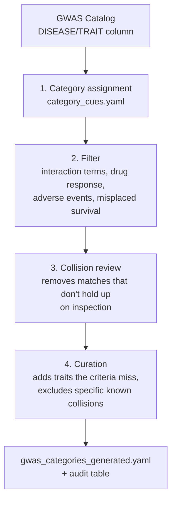

# How GWAS Catalog traits are assigned to categories

Traits from the GWAS Catalog are grouped into 65 categories spanning the major
physiological and disease domains covered by the analysis (full list:
`category_definitions.yaml`). Assignment is rule-based throughout: each category has
explicit inclusion criteria, general filters remove trait types that don't belong in any
category, and a collision review removes keyword matches that don't hold up on inspection.
Every step is logged.

## Process



**1. Category assignment.** Each category has a set of inclusion criteria — words or
phrases that identify it, e.g. `hdl`, `type 1 diabetes`, `seropositivity` (`category_cues.yaml`).
A trait is assigned to every category whose criteria it matches. A trait can belong to more
than one category where it is genuinely pleiotropic (e.g. "Body mass index or breast cancer
(pleiotropy)" belongs to both BMI and Cancer).

**2. Filter.** Removes trait types that don't belong in any category regardless of keyword
match: gene-by-environment interaction terms, drug-response and drug-induced traits, adverse
drug reactions (outside Pharmacogenomics), and specifically misplaced survival/protein
traits. Multi-trait and pleiotropy entries are explicitly kept.

**3. Collision review.** Removes keyword matches that are coincidental rather than
meaningful — the word matched, but the trait doesn't belong. Examples: "hip fracture" is
excluded from *Body Composition* (it matched "hip", but it's a disease, not a body-shape
measure); craniofacial "nose height" is excluded from *Height and Growth*; a type-1-only
diabetes trait is excluded from the type 2/glucose category.

**4. Curation.** A small number of traits the inclusion criteria don't catch are added
directly (`supplement_memberships.tsv`); specific keyword collisions not resolved by rule 3
are excluded directly (`exclusions.tsv`).

Categories outside these 65 domains — proteomics, metabolomics, gene expression, genomic
features, brain imaging — are not part of the vocabulary at all, so no trait can be assigned
to them; nothing needs to actively exclude them.

## Categories

65 categories, each with a short definition and its inclusion/exclusion scope in
`category_definitions.yaml`. Sensory perception is split into two categories — *Hearing*
and *Taste and Smell* — kept separate because they are distinct sensory modalities.

## Running it

```
python build_gwas_categories.py --catalog gwas_catalog_GRCh37.tsv \
    --cues category_cues.yaml --supplement supplement_memberships.tsv \
    --overrides manual_overrides.tsv --exclusions exclusions.tsv \
    --out gwas_categories_generated.yaml --audit build_audit.tsv
```

`build_audit.tsv` records, for every trait, which rule added or removed it and why. See
`README.md` for the file layout.
